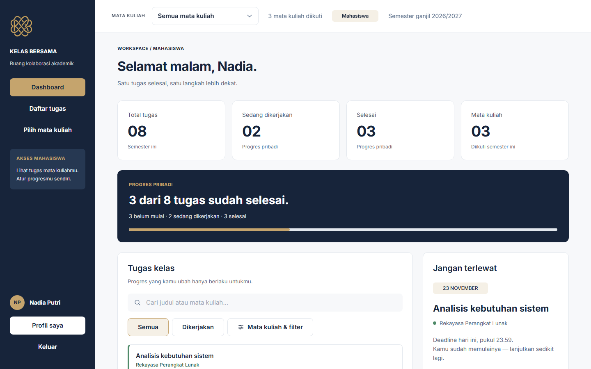
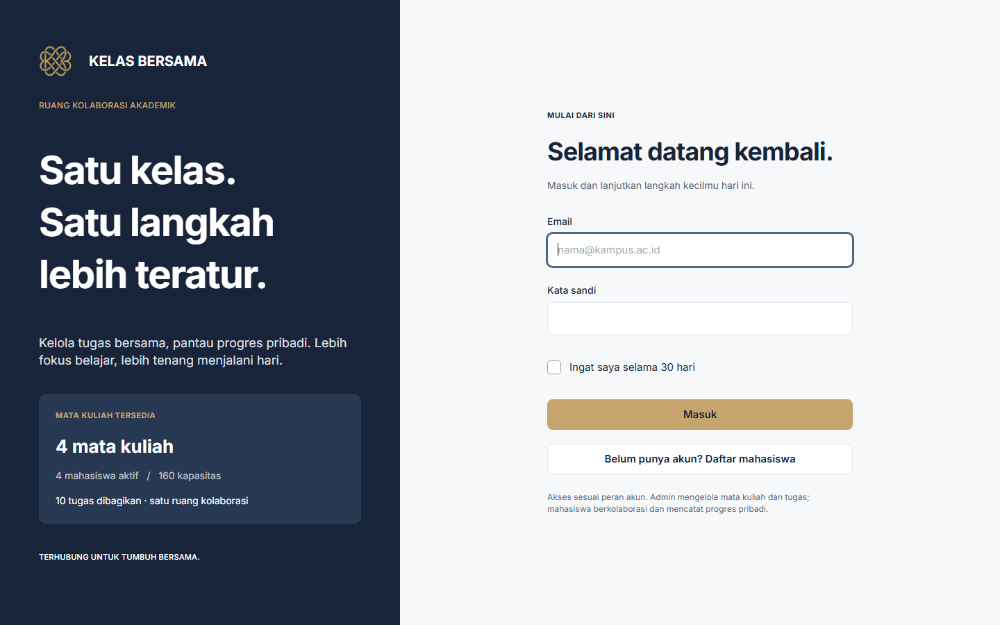
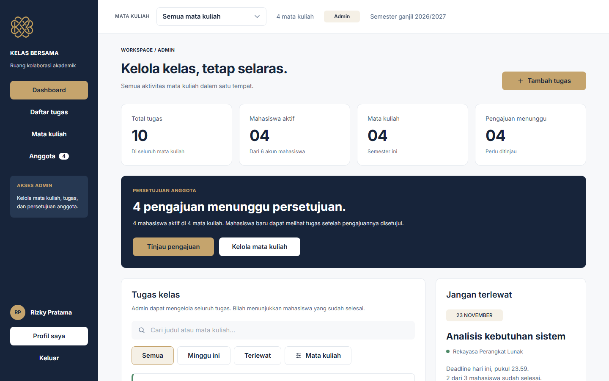
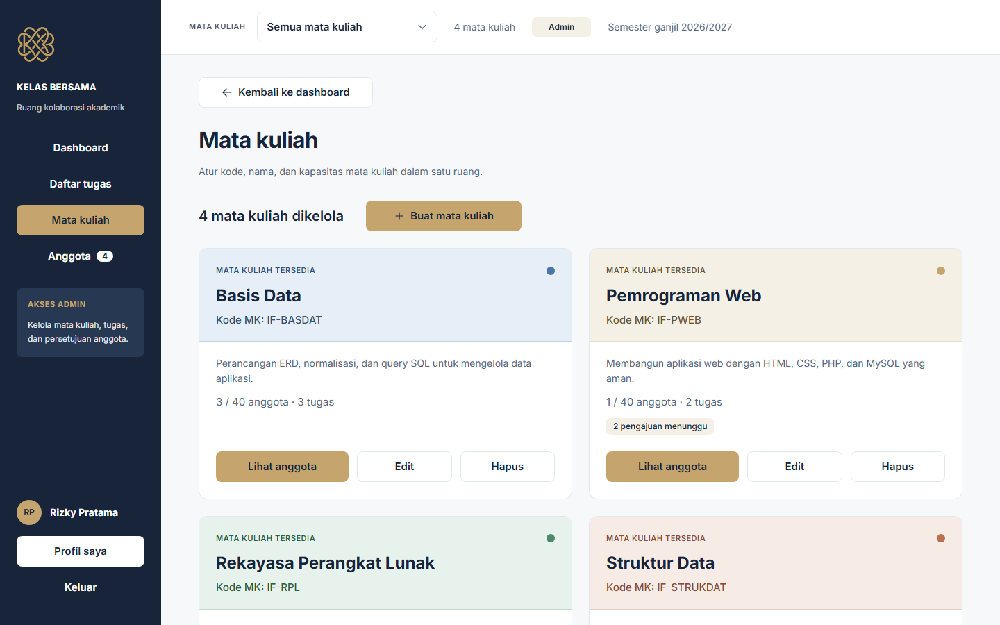
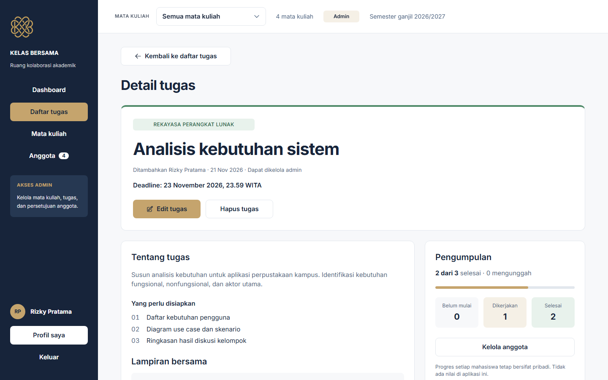
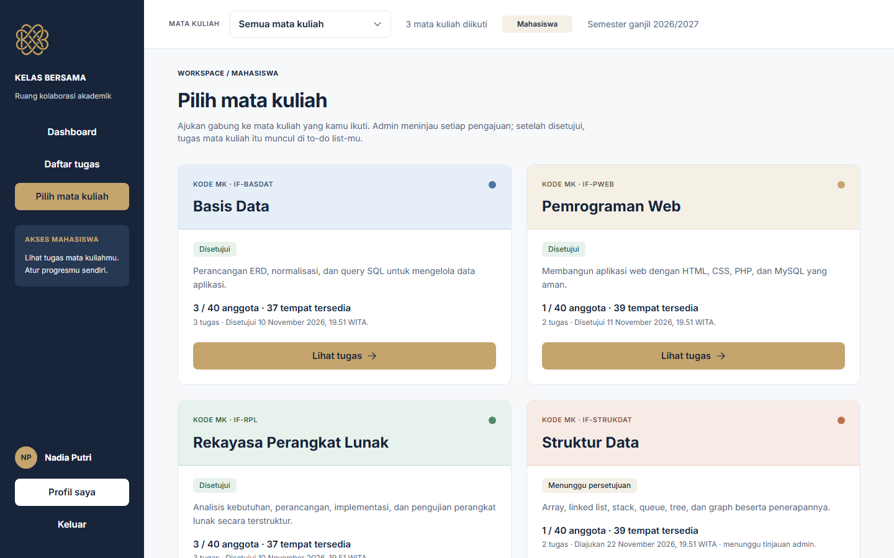
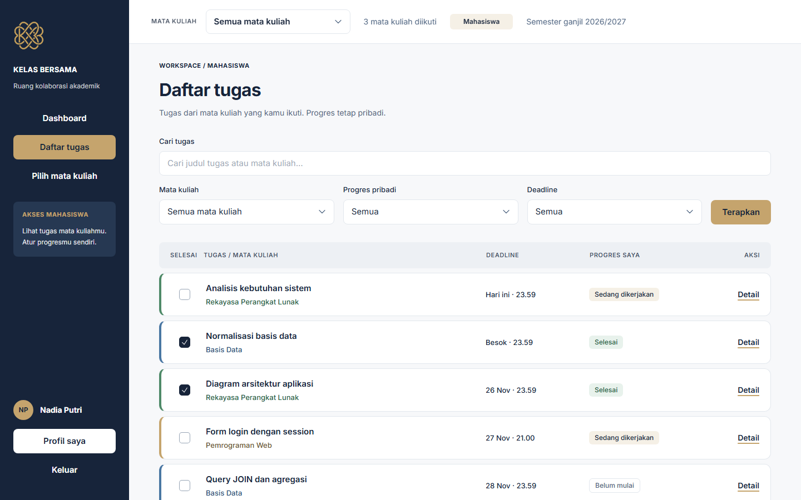
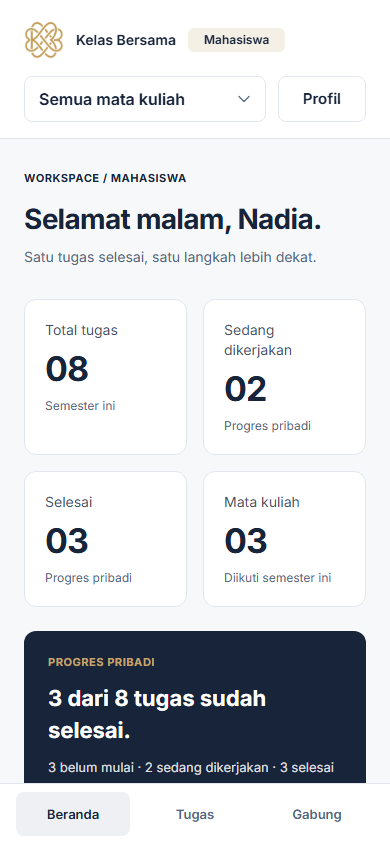
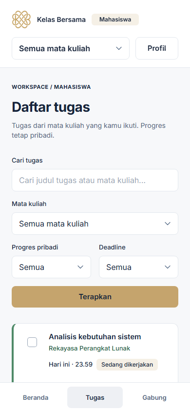
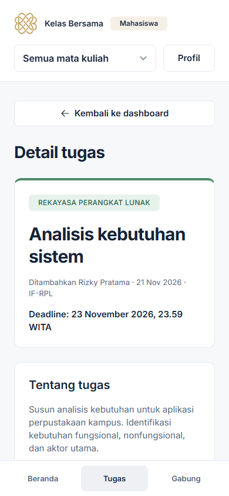

# Kelas Bersama

Aplikasi web untuk mengelola tugas kuliah bersama. Admin membuat mata kuliah dan daftar tugas;
mahasiswa mengajukan diri ke mata kuliah, mencatat progres masing-masing, dan mengunggah hasil kerja.

Proyek akhir mata kuliah Pemrograman Web, Teknik Informatika UMKT.



## Fitur

Mahasiswa

- Daftar akun, masuk, dan opsi "ingat saya" selama 30 hari.
- Mengajukan diri ke mata kuliah. Tugasnya baru muncul setelah pengajuan disetujui admin.
- Daftar tugas dengan pencarian, filter, dan centang selesai langsung dari daftar.
- Progres pribadi per tugas (belum mulai, sedang dikerjakan, selesai) yang tidak terlihat teman lain.
- Unggah hasil kerja (PDF, DOC/DOCX, gambar) dengan pratinjau sebelum dikirim.
- Profil, foto profil, dan ganti password.

Admin

- Mengelola mata kuliah: kode, kapasitas, dan warna kartunya.
- Menyetujui, menolak, atau mengeluarkan anggota mata kuliah.
- Mengelola tugas beserta lampiran referensi.
- Melihat pengumpulan setiap tugas dan mengunduh hasil kerja mahasiswa.

## Teknologi

- PHP 8 tanpa framework, PDO
- MySQL / MariaDB (XAMPP)
- Tailwind CSS v4 lewat CDN, tanpa proses build
- JavaScript tanpa library

## Menjalankan di komputer sendiri

Yang dibutuhkan hanya [XAMPP](https://www.apachefriends.org) dengan PHP 8.

1. Clone repo ini ke folder `htdocs`.

   ```bash
   cd C:\xampp\htdocs
   git clone https://github.com/Naffrize/uas-kelas-bersama.git
   ```

2. Nyalakan Apache dan MySQL dari XAMPP Control Panel.
3. Buka http://localhost/phpmyadmin, lalu lewat tab Import masukkan file dari
   `kelas-bersama/database/` dengan urutan berikut:
   - `schema.sql` (membuat database `uas_kelas_bersama`)
   - `seed.sql` (mata kuliah contoh)
   - `demo.sql` (akun dan data demo)
4. Salin pengaturan database.

   ```bash
   cd uas-kelas-bersama\kelas-bersama
   copy config\koneksi.example.php config\koneksi.php
   ```

   Sesuaikan port atau password di file itu kalau XAMPP-mu tidak memakai pengaturan bawaan.
5. Buka http://localhost/uas-kelas-bersama/kelas-bersama/public/

Kalau halaman tidak tampil dengan benar, buka `public/cek-koneksi.php`. Halaman itu menunjukkan
bagian mana yang belum siap.

Sudah memakai database dari versi sebelumnya? Impor `database/migrasi-warna-matkul.sql` sekali
supaya kolom warna mata kuliah tersedia. Data lama tidak terhapus.

## Akun demo

Tersedia setelah `demo.sql` diimpor.

| Peran | Email | Password |
|---|---|---|
| Admin | admin@demo.kelasbersama.test | admin12345 |
| Mahasiswa | nadia@demo.kelasbersama.test | mahasiswa123 |

Akun mahasiswa lain: aditya, salsabila, raka, dimas, dan intan, dengan domain dan password yang
sama. Intan belum tergabung di mata kuliah mana pun, jadi bisa dipakai untuk melihat tampilan kosong.

Jangan impor `demo.sql` di server yang bisa diakses publik.

## Tangkapan layar

| | |
|---|---|
|  |  |
|  |  |
|  |  |

| | | |
|---|---|---|
|  |  |  |

## Struktur proyek

```text
kelas-bersama/
├── app/        kode PHP bersama, tidak bisa dibuka dari browser
│   └── tampilan/   HTML setiap halaman
├── config/     pengaturan koneksi database
├── database/   skema, data contoh, data demo
├── docs/       PRD, flowchart, roadmap, hasil uji, panduan pengembang
├── public/     halaman yang dibuka browser
├── storage/    file unggahan (privat)
└── tools/      skrip baris perintah, misalnya membuat akun admin
```

Pola kode, aturan keamanan, dan cara menambah halaman dijelaskan di
[Panduan Pengembang](kelas-bersama/docs/PANDUAN-PENGEMBANG.md).

## Dokumentasi

- [PRD](kelas-bersama/docs/PRD.md): kebutuhan dan aturan bisnis
- [Flowchart & ERD](kelas-bersama/docs/FLOWCHART.md)
- [Roadmap](kelas-bersama/docs/ROADMAP.md): urutan pengerjaan
- [Hasil uji](kelas-bersama/docs/HASIL-UJI.md)
- [Panduan pengembang](kelas-bersama/docs/PANDUAN-PENGEMBANG.md)

## Tim

| Bagian | Anggota |
|---|---|
| Autentikasi dan profil | |
| Mata kuliah dan persetujuan anggota | |
| Tugas (admin) | |
| To-do dan unggah hasil (mahasiswa) | |
| Tampilan dan pengujian | |

## Catatan

Pengerjaan proyek ini dibantu alat AI (Claude Code). Rincian penggunaannya dicantumkan di laporan akhir.
