# Kelas Bersama (K/B)

Ruang kolaborasi akademik berbasis web — proyek akhir pengganti UAS mata kuliah
Pemrograman Web, Teknik Informatika UMKT. Admin mengelola mata kuliah dan to-do list
tugas; mahasiswa mengajukan gabung mata kuliah (menunggu persetujuan admin),
mencentang progres pribadi, dan mengunggah hasil kerja.

> **Status:** semua fase di [docs/ROADMAP.md](docs/ROADMAP.md) (0–9) selesai.
> 97 uji server + 17 uji JavaScript lulus — lihat [docs/HASIL-UJI.md](docs/HASIL-UJI.md).

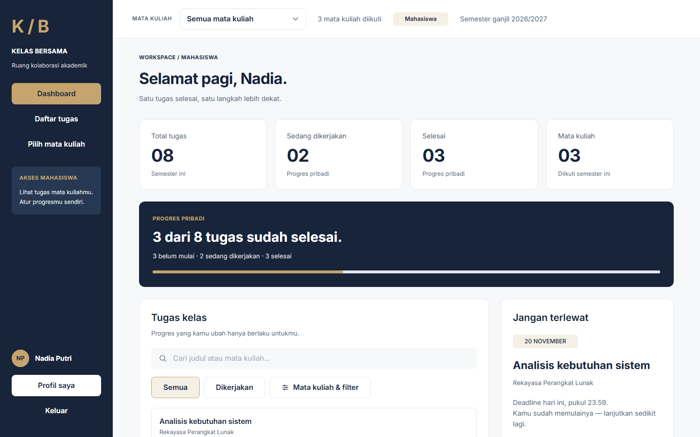

## Fitur

**Mahasiswa**
- Registrasi, masuk (opsi "Ingat saya selama 30 hari"), keluar dengan konfirmasi.
- Pilih mata kuliah: ajukan gabung, batalkan, ajukan ulang; status & sisa kuota terlihat.
- Dashboard: salam sesuai jam, statistik progres, banner progres pribadi, kartu "Jangan terlewat", cari & filter.
- Daftar tugas (tabel di desktop, kartu di HP): cari, filter mata kuliah/progres/deadline, paginasi, ceklis langsung.
- Detail tugas: deskripsi, persiapan bernomor, lampiran, ubah progres (Belum mulai / Sedang dikerjakan / Selesai),
  unggah / ganti / hapus hasil kerja dengan pratinjau sebelum disimpan (label *Terlambat* bila lewat deadline).
- Profil: ubah nama, foto profil dengan pratinjau, ganti kata sandi.

**Admin**
- Dashboard: statistik, banner pengajuan menunggu + "Tinjau pengajuan", daftar tugas, "Jangan terlewat".
- Kelola mata kuliah lewat modal buat / edit / hapus (kode unik, kapasitas 1–500).
- Anggota: tab *Menunggu* (Setujui / Tolak) dan *Disetujui* (Keluarkan), filter mata kuliah, cari nama/email.
  Kuota dijaga di dalam transaksi (`SELECT … FOR UPDATE`).
- Kelola tugas + lampiran referensi; detail tugas dengan tabel *Pengumpulan* (status, file, waktu unggah) dan unduh hasil kerja.

## Akun demo

Impor `database/demo.sql` (setelah `schema.sql` dan `seed.sql`) untuk data presentasi:

| Peran | Email | Kata sandi |
|---|---|---|
| Admin | `admin@demo.kelasbersama.test` | `admin12345` |
| Mahasiswa | `nadia@demo.kelasbersama.test` | `mahasiswa123` |
| Mahasiswa | `aditya@`, `salsabila@`, `raka@`, `dimas@`, `intan@` + `demo.kelasbersama.test` | `mahasiswa123` |

Intan belum punya mata kuliah yang disetujui (contoh tampilan kosong). **Jangan impor `demo.sql`
di server publik** — kata sandinya tercantum di sini.

## Tangkapan layar

| Desktop (1440 px) | |
|---|---|
| 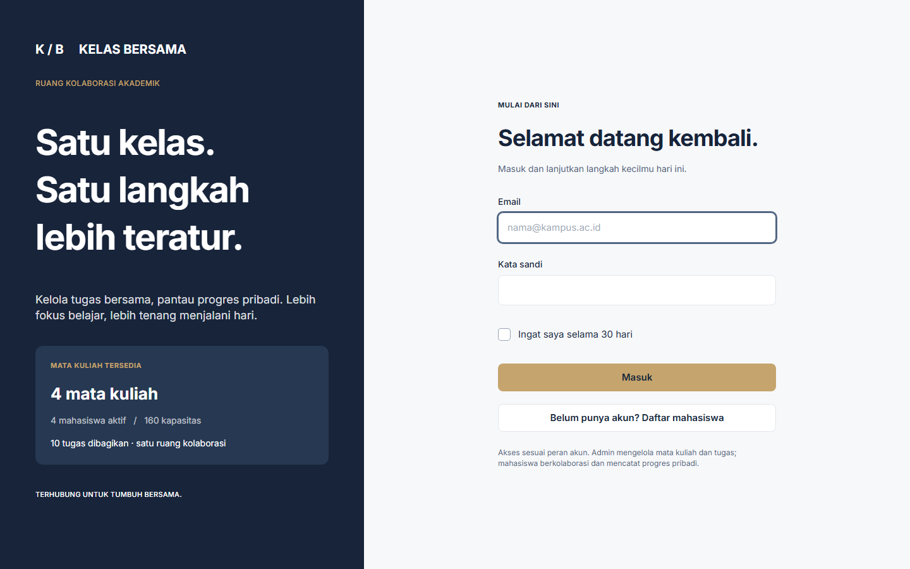 | 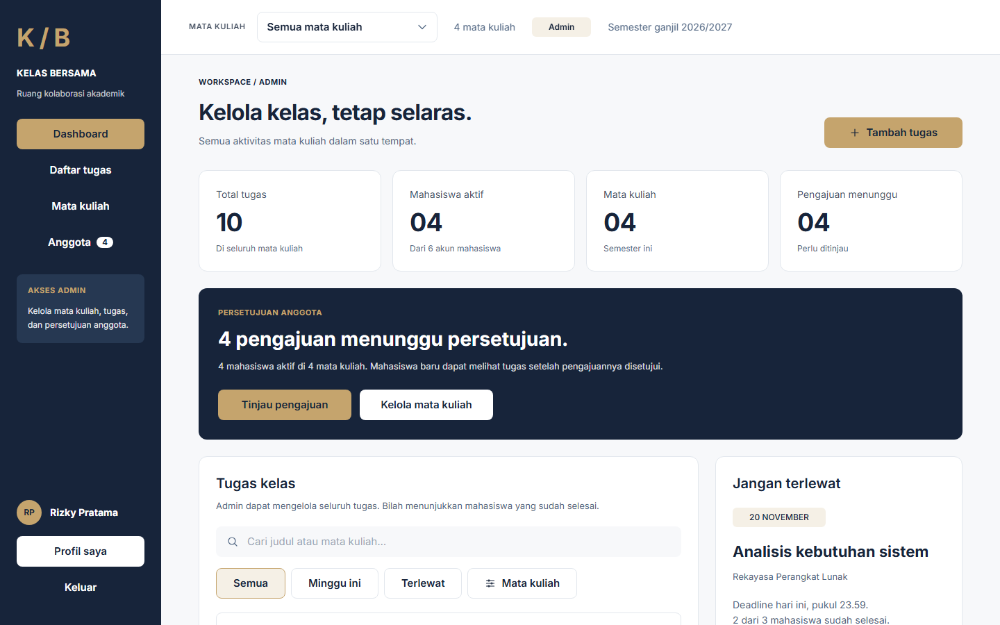 |
| 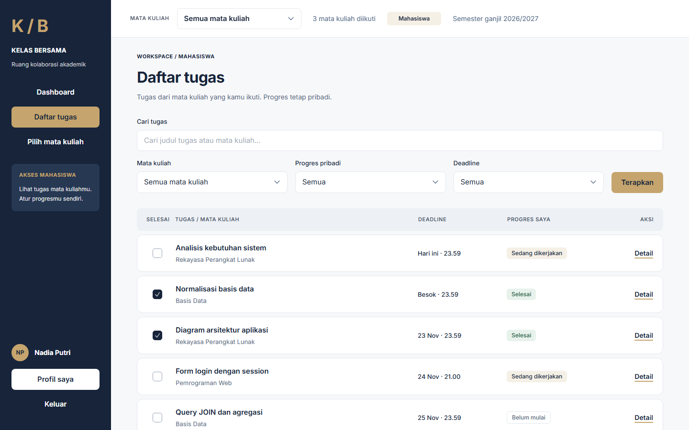 | 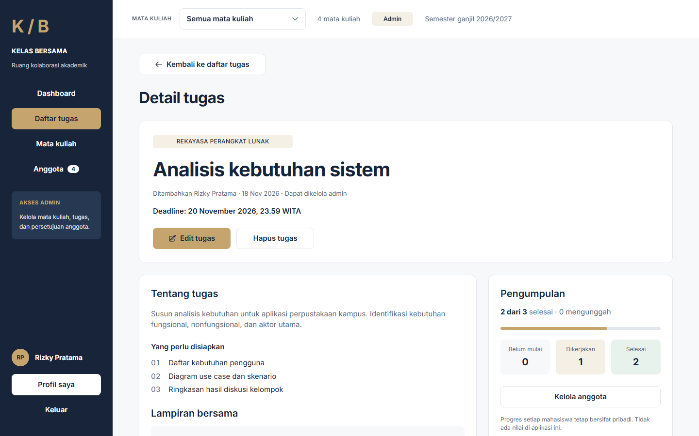 |
| 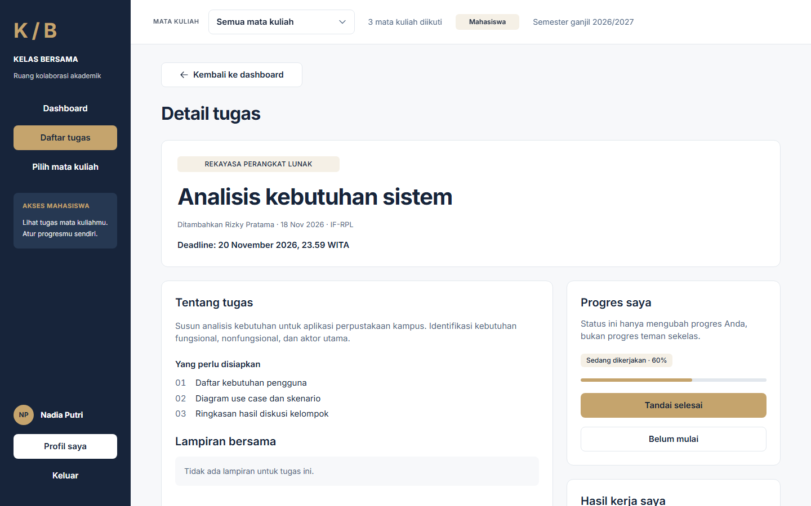 | 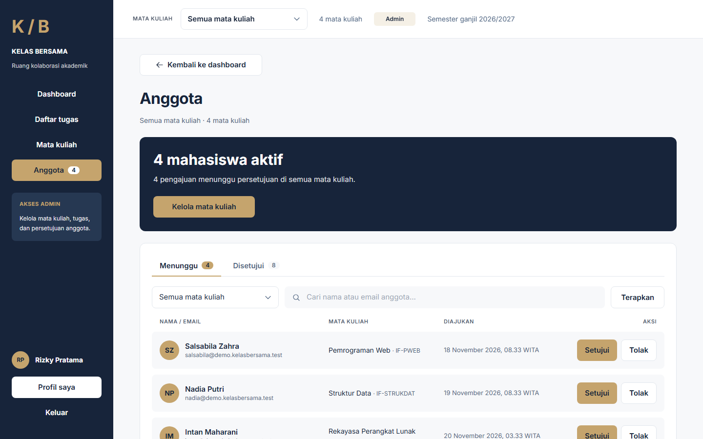 |

| HP (390 px) | | | |
|---|---|---|---|
| 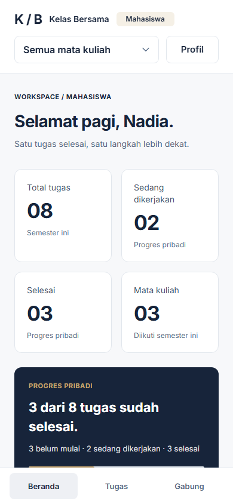 | 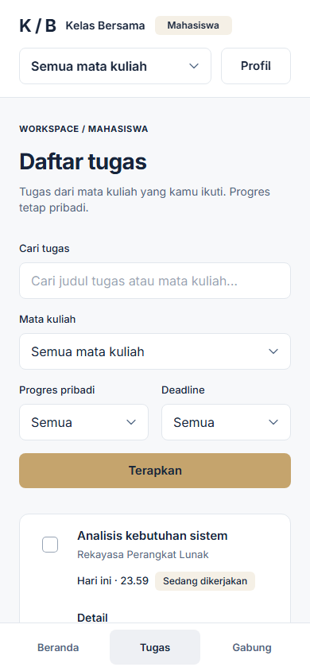 | 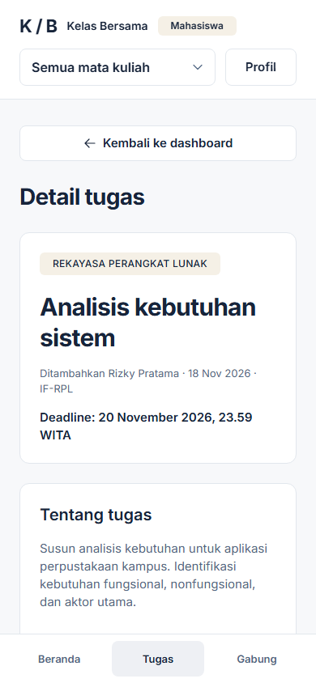 | 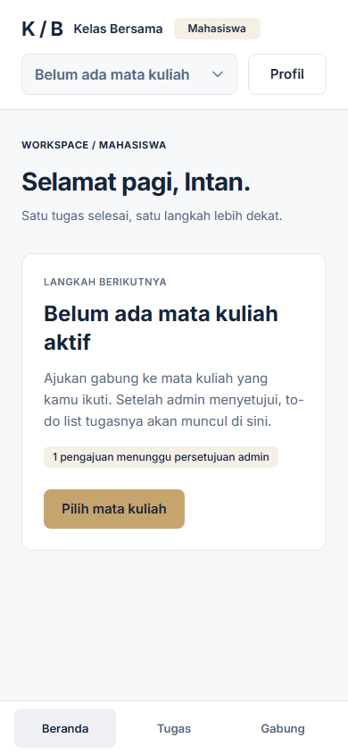 |

Semua gambar ada di [docs/tangkapan-layar/](docs/tangkapan-layar/).

## Teknologi

- PHP 8 native (tanpa framework, tanpa Composer), PDO + MySQL/MariaDB lewat XAMPP
- Tailwind CSS v4 lewat **CDN resmi** (jsDelivr) — tanpa instalasi Node dan tanpa build;
  tema di `public/assets/css/tema.css`, salinan lokal dipakai otomatis saat offline
- Tampilan berupa file **HTML murni** (`app/tampilan/*.html`) yang diisi data oleh mesin templat
  kecil buatan sendiri (`app/templat.php`, sintaks `{{ }}` ala Mustache)
- JavaScript vanilla seperlunya (`public/assets/js/app.js`: modal, konfirmasi, pratinjau file, ceklis otomatis)

## Struktur folder

```text
kelas-bersama/
├── app/                kode PHP bersama (403 dari browser)
│   ├── keamanan.php    session, token CSRF, header keamanan, zona waktu
│   ├── auth.php        guard login/peran + "Ingat saya"
│   ├── helper.php      db(), url(), e(), redirect303(), flash, format tanggal WITA
│   ├── kueri.php       query bersama: filter, paginasi, statistik, tugas per peran
│   ├── komponen.php    data komponen tampilan: lencana, avatar, opsi select, paginasi
│   ├── upload.php      validasi & simpan unggahan (finfo, nama acak)
│   ├── templat.php     mesin templat: mengisi {{ }} di file .html (escape otomatis)
│   ├── tampilan.php    tampilkanHalaman(): merakit halaman dari file .html
│   └── tampilan/       ★ HTML MURNI (tanpa kode PHP)
│       ├── login.html, register.html, profil.html, galat.html, cek-koneksi.html
│       ├── admin/      dashboard, tugas, tugas-form, tugas-detail, matkul, anggota (.html)
│       ├── mahasiswa/  dashboard, tugas, tugas-detail, matkul (.html)
│       ├── layout/     halaman, kepala, sidebar, topbar, nav-bawah, flash, modal-konfirmasi,
│       │               modal-filter, paginasi, panel-auth, tentang-tugas (.html)
│       └── komponen/   avatar-9/-10, lencana-progres/-pendaftaran/-terlewat/-terlambat, panah-pilihan
├── config/             koneksi.example.php → salin jadi koneksi.php (403)
├── database/           schema.sql, seed.sql, demo.sql (403)
├── docs/               PRD, flowchart, roadmap, desain Figma, hasil uji, tangkapan layar
├── public/             SATU-SATUNYA folder yang dibuka browser — berisi LOGIKA (tanpa HTML)
│   ├── admin/          dashboard, tugas(+form/simpan/hapus/detail), matkul(+simpan/hapus), anggota(+aksi)
│   ├── mahasiswa/      dashboard, tugas, tugas-detail, progres-simpan, hasil-unggah/hapus, matkul(+aksi)
│   ├── assets/         css/tema.css (tema Tailwind), js/app.js, js/tailwind-cadangan.js,
│   │                   js/vendor/ (salinan Tailwind untuk offline), favicon.svg
│   ├── uploads/foto/   foto profil (.htaccess menolak eksekusi skrip)
│   └── index.php, login.php, register.php, logout.php, profil*.php, unduh.php, cek-koneksi.php
├── storage/            uploads/lampiran, uploads/hasil — file privat (403)
└── tools/              buat-admin.php (CLI, 403)
```

## Pemisahan logika & tampilan

Setiap halaman terdiri dari dua file:

| Peran | Letak | Isi |
|---|---|---|
| **Logika** | `public/<halaman>.php` | guard login/peran, membaca input, query database, validasi — **tanpa HTML** |
| **Tampilan** | `app/tampilan/<halaman>.html` | **HTML murni** + class Tailwind — **tanpa kode PHP** |

File logika selalu diakhiri dengan `tampilkanHalaman()`. Fungsi itu mengisi file `.html`
dengan data, lalu memasangnya di kerangka `layout/halaman.html` (kepala, sidebar, topbar, dst.):

```php
// public/admin/matkul.php — LOGIKA
$pengguna = wajibAdmin();
$daftarMataKuliah = db()->query('SELECT ... FROM mata_kuliah ...')->fetchAll();
tampilkanHalaman('admin/matkul', [
    'judulHalaman' => 'Mata kuliah',
    'menuAktif' => 'matkul',
    'pengguna' => $pengguna,
    'daftarMataKuliah' => $daftarMataKuliah,
]);
```

```html
<!-- app/tampilan/admin/matkul.html — TAMPILAN (HTML murni) -->
<h1 class="judul-halaman mt-6">Mata kuliah</h1>
<ul class="mt-6 grid gap-4 lg:grid-cols-2">
    {{#daftarMataKuliah}}
        <li class="kartu flex flex-col p-6">
            <h3 class="mt-3 text-2xl font-bold leading-8">{{nama}}</h3>
            <p>Kode MK: {{kode}}</p>
        </li>
    {{/daftarMataKuliah}}
</ul>
{{^daftarMataKuliah}}
    <p>Belum ada mata kuliah.</p>
{{/daftarMataKuliah}}
```

Tanda yang dipakai di file `.html` (mesin `app/templat.php`, gaya [Mustache](https://mustache.github.io)):

| Tanda | Arti |
|---|---|
| `{{nama}}` | cetak data sebagai teks — **otomatis di-escape** (aturan keamanan no. 6) |
| `{{tugas.judul}}` | ambil isi data bertingkat |
| `{{#daftar}} … {{/daftar}}` | ulangi untuk setiap isi daftar, atau tampilkan bila nilainya "ya" |
| `{{^daftar}} … {{/daftar}}` | tampilkan bila daftar kosong / nilainya "tidak" |
| `{{> layout/sidebar}}` | sisipkan file `.html` lain |
| `{{! catatan }}` | komentar, tidak dikirim ke browser |

Catatan:

- File `.html` tidak berisi query, `if` PHP, atau `foreach`. Semua data (termasuk tanggal yang
  sudah diformat dan tanda ya/tidak seperti `terlewat`) disiapkan file logika.
- Data yang salah ketik (`{{namaa}}`) langsung memunculkan galat, tidak diam-diam kosong.
- File tampilan ada di `app/`, yang diblokir `.htaccess` (403). Jadi tampilan **tidak bisa dibuka
  langsung** tanpa melewati guard di file logika.
- File aksi (`*-simpan.php`, `*-hapus.php`, `*-aksi.php`, `logout.php`, `unduh.php`) tidak punya
  tampilan: file-file ini hanya memproses POST lalu redirect 303.

## Instalasi (XAMPP di Windows)

### 1. Taruh proyek di `htdocs`

Cara yang disarankan adalah *junction*: repo tetap di folder kuliah, tetapi XAMPP melihatnya
di `htdocs`, sehingga setiap perubahan langsung terlihat. Jalankan di **Command Prompt**:

```bat
mklink /J C:\xampp\htdocs\kelas-bersama "D:\lokasi\repo\uas-kelas-bersama\kelas-bersama"
```

URL-nya menjadi `http://localhost/kelas-bersama/public/`. Jika folder `C:\xampp\htdocs\kelas-bersama`
sudah ada, ganti dulu namanya. Alternatif: clone repo langsung ke `htdocs`, lalu buka
`http://localhost/uas-kelas-bersama/kelas-bersama/public/` (alamat aplikasi menyesuaikan otomatis).

> Untuk melepas junction, jalankan `rmdir C:\xampp\htdocs\kelas-bersama` di Command Prompt —
> hanya tautannya yang hilang, isi repo tetap aman. Jangan menghapus *isi* folder junction,
> karena itu sama dengan menghapus file di repo.

### 2. Jalankan Apache dan MySQL

Klik **Start** pada Apache dan MySQL di XAMPP Control Panel.

### 3. Impor database

Buka phpMyAdmin (`http://localhost/phpmyadmin`) → tab **Import**, lalu impor berurutan:

1. `database/schema.sql` — membuat database `uas_kelas_bersama` dan 6 tabel
2. `database/seed.sql` — 4 mata kuliah contoh (tanpa akun)
3. `database/demo.sql` — *opsional*, akun & data demo untuk presentasi

> Impor ulang `schema.sql` **menghapus semua data**, termasuk akun. Lakukan hanya saat skema berubah.

### 4. Atur koneksi

```bat
copy config\koneksi.example.php config\koneksi.php
```

Sesuaikan `$dbPort` (3306 atau 3307) dan `$dbSandi` bila perlu. `config/koneksi.php` tidak ikut di-commit.

### 5. Buat akun admin (bila tidak memakai data demo)

Admin tidak bisa mendaftar lewat web:

```bat
C:\xampp\php\php.exe tools\buat-admin.php
```

### 6. Buka aplikasi

Buka `http://localhost/kelas-bersama/public/` → halaman masuk. Untuk memeriksa instalasi
(PHP, database, tabel, tema Tailwind, batas unggah, zona waktu) buka `public/cek-koneksi.php`
— hanya bisa dari localhost.

## Mengubah tampilan (Tailwind CSS)

**Tidak perlu install apa pun.** Tailwind dimuat dari CDN resmi di `app/tampilan/layout/kepala.html`:

```html
<script src="https://cdn.jsdelivr.net/npm/@tailwindcss/browser@4.3.5/dist/index.global.js"
        integrity="sha384-..." crossorigin="anonymous"></script>
```

Cara mengubah tampilan:

1. Edit class Tailwind langsung di file `.html` di `app/tampilan/`.
2. Muat ulang browser. Tailwind di browser membuat CSS untuk class baru secara otomatis, tanpa build.

Design token & komponen ada di `public/assets/css/tema.css`: warna `bg-navy`, `bg-navy-muda`,
`text-slate`, `bg-warm`, `bg-gold`, `bg-gold-muda`, `border-garis`, `bg-hijau-muda`, dan komponen
`tombol tombol-emas|tombol-putih|tombol-navy`, `kartu`, `masukan`, `label`, `lencana`, `progres`, `modal`.

Hal yang perlu diketahui:

- **Versi dipatok** (4.3.5) dan dicek `integrity` (SRI), jadi isi file CDN tidak bisa diganti diam-diam.
- **Tanpa internet**, `public/assets/js/tailwind-cadangan.js` otomatis memuat salinan lokal versi yang sama
  (`public/assets/js/vendor/`). Tampilan tetap rapi saat presentasi offline; hanya font Inter yang
  berganti font sistem.
- Tidak ada atribut `style` dan skrip inline. Header CSP hanya mengizinkan skrip dari server sendiri
  + jsDelivr.

## Keamanan (10 aturan CLAUDE.md)

| Aturan | Penerapan |
|---|---|
| 1. Prepared statement | Semua query lewat `prepare()`/`execute()` atau `jalankan()`; filter dinamis hanya menggabung potongan SQL tetap (`app/kueri.php`) |
| 2. `password_hash` & `session_regenerate_id` | `register.php`, `tools/buat-admin.php`, `profil-sandi.php`; `masukkanPengguna()` di `app/auth.php` |
| 3. Token CSRF | `app/keamanan.php` memeriksa setiap POST (gagal → 400); `<input type="hidden" name="csrf" value="{{csrf}}">` di setiap form |
| 4. Guard | `wajibLogin()` / `wajibAdmin()` / `wajibMahasiswa()` di baris awal setiap halaman |
| 5. Cegah IDOR | `tugasUntukMahasiswa()` selalu JOIN pendaftaran `disetujui`; ID mahasiswa dari session, bukan form |
| 6. Escaping | Di file `.html`, `{{data}}` otomatis lewat `htmlspecialchars` (`app/templat.php`); `{{{ }}}` hanya mencetak objek `HtmlAman` buatan kode sendiri |
| 7. Logout POST | `public/logout.php` + modal konfirmasi |
| 8. Upload | `app/upload.php`: kode error, ≤ 5 MB, MIME dari `finfo`, `getimagesize`, nama acak; file lama dihapus setelah DB berhasil |
| 9. Unduh file privat | `public/unduh.php` memeriksa hak akses; `storage/` diblokir `.htaccess` |
| 10. Pesan login generik | `login.php` — pesan sama + hash pengganti agar waktu respons sama |
| Tambahan | CSP: skrip hanya dari server sendiri + CDN Tailwind (versi dipatok + SRI), tanpa skrip inline; `X-Frame-Options`, `nosniff`, `no-store`, cookie session khusus, kuota dikunci `FOR UPDATE`, alamat `kembali` hanya internal |

## Pengujian

Skenario U-01..U-18 dari PRD beserta uji keamanan & JavaScript tercatat di
[docs/HASIL-UJI.md](docs/HASIL-UJI.md) (input, harapan, hasil aktual).

## Alur kerja tim

- Branch `main` selalu bisa dijalankan. Fitur dikerjakan di branch `fitur/<nama>`, digabung lewat
  Pull Request yang di-review minimal 1 anggota. Pesan commit: `feat: …`, `fix: …`, `docs: …`, `style: …`.
- Jangan commit `config/koneksi.php`, isi `storage/uploads/`, dan isi `public/uploads/foto/`.
- Skema berubah? Tulis ulang `database/schema.sql`, lalu kabari anggota untuk impor ulang.

Pembagian modul (PRD bagian 12) — isi nama anggota yang menjelaskan modul saat presentasi:

| Modul | Berkas utama | Anggota |
|---|---|---|
| 1. Auth + profil | `app/keamanan.php`, `app/auth.php`, `login.php`, `register.php`, `logout.php`, `profil*.php` | … |
| 2. Mata kuliah + persetujuan | `admin/matkul*.php`, `admin/anggota*.php`, `mahasiswa/matkul*.php` | … |
| 3. Tugas admin | `admin/tugas*.php`, `app/upload.php`, `unduh.php` | … |
| 4. To-do mahasiswa + upload | `mahasiswa/tugas*.php`, `progres-simpan.php`, `hasil-*.php`, dashboard | … |
| 5. Layout/Tailwind + QA | `app/templat.php`, `app/tampilan.php`, `app/tampilan/layout/`, `app/tampilan/komponen/`, `assets/css/tema.css`, `docs/HASIL-UJI.md` | … |

Setiap modul juga memegang file tampilannya di `app/tampilan/` (misalnya modul 2 →
`app/tampilan/admin/matkul.html`, `admin/anggota.html`, `mahasiswa/matkul.html`).

## Dokumen

| Dokumen | Isi |
|---|---|
| [docs/PRD.md](docs/PRD.md) | Kebutuhan lengkap, aturan bisnis, desain data, rencana uji |
| [docs/FLOWCHART.md](docs/FLOWCHART.md) | Alur & ERD (Mermaid), versi gambar di `docs/flowchart-png/` |
| [docs/ROADMAP.md](docs/ROADMAP.md) | Urutan pengerjaan per fase |
| [docs/HASIL-UJI.md](docs/HASIL-UJI.md) | Hasil uji U-01..U-18 + uji tambahan |
| [docs/design/README.md](docs/design/README.md) | Pemetaan layar Figma ke halaman |

## Masalah umum

| Gejala | Solusi |
|---|---|
| "Koneksi database gagal. MySQL belum berjalan atau port salah." | Start MySQL; cocokkan port di XAMPP Control Panel dengan `$dbPort` |
| "Koneksi database gagal. Database belum ada." | Impor `database/schema.sql` |
| "config/koneksi.php belum ada." | Lakukan langkah 4 |
| Halaman tampil polos tanpa gaya | CDN tidak terjangkau **dan** salinan lokal `public/assets/js/vendor/tailwindcss-browser-4.3.5.js` hilang → ambil ulang dari repo; cek `public/cek-koneksi.php` |
| Galat "data {{…}} tidak dikirim oleh file logika" | Nama di file `.html` salah ketik, atau data itu belum ditambahkan di `tampilkanHalaman()` file logikanya |
| `'php' is not recognized ...` | Pakai `C:\xampp\php\php.exe`, atau tambahkan `C:\xampp\php` ke PATH |
| Unggahan file gagal / "Kiriman terlalu besar" | `upload_max_filesize` & `post_max_size` di `php.ini` minimal `8M`, lalu restart Apache |
| Selalu "Email atau kata sandi salah" padahal akun demo diketik benar | Akun demo belum ada: impor `database/demo.sql` (setiap kali `schema.sql` diimpor ulang, semua akun ikut terhapus). Cek di `cek-koneksi.php` baris "Akun admin" |

## Transparansi penggunaan AI

Sesuai panduan jobsheet P10, proyek ini dikerjakan dengan bantuan **Claude Code** (Anthropic)
mengikuti `CLAUDE.md`, `docs/PRD.md`, dan `docs/ROADMAP.md`. Setiap file diberi komentar per
BAGIAN agar alurnya (request → validasi → SQL → output) dapat dijelaskan oleh anggota kelompok.
Catat penggunaan AI ini di laporan akhir.
