# Flowchart & Diagram — Kelas Bersama

Semua diagram memakai Mermaid sehingga tampil langsung di GitHub dan di VS Code
(ekstensi *Markdown Preview Mermaid Support*). Versi gambar ada di `docs/flowchart-png/`.

Daftar isi:
1. Peta situs (sitemap)
2. Alur umum sistem
3. Registrasi & login
4. Pengajuan mata kuliah & persetujuan admin
5. Admin mengelola mata kuliah (CRUD)
6. Admin mengelola tugas (CRUD + lampiran)
7. Mahasiswa mengerjakan tugas (ceklis + upload)
8. Validasi upload di server
9. Otorisasi unduh file
10. State diagram status
11. ERD

---

## 1. Peta situs

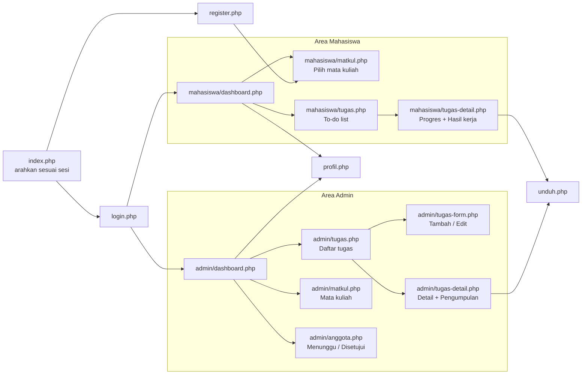

## 2. Alur umum sistem

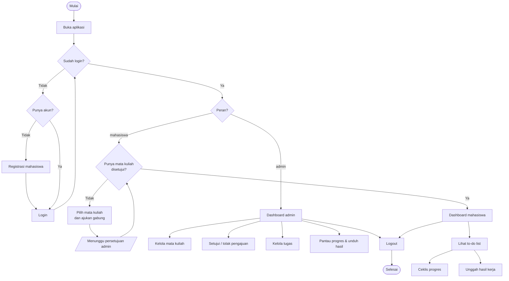

## 3. Registrasi & login

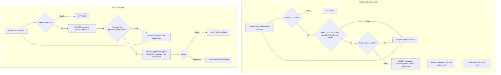

## 4. Pengajuan mata kuliah & persetujuan admin

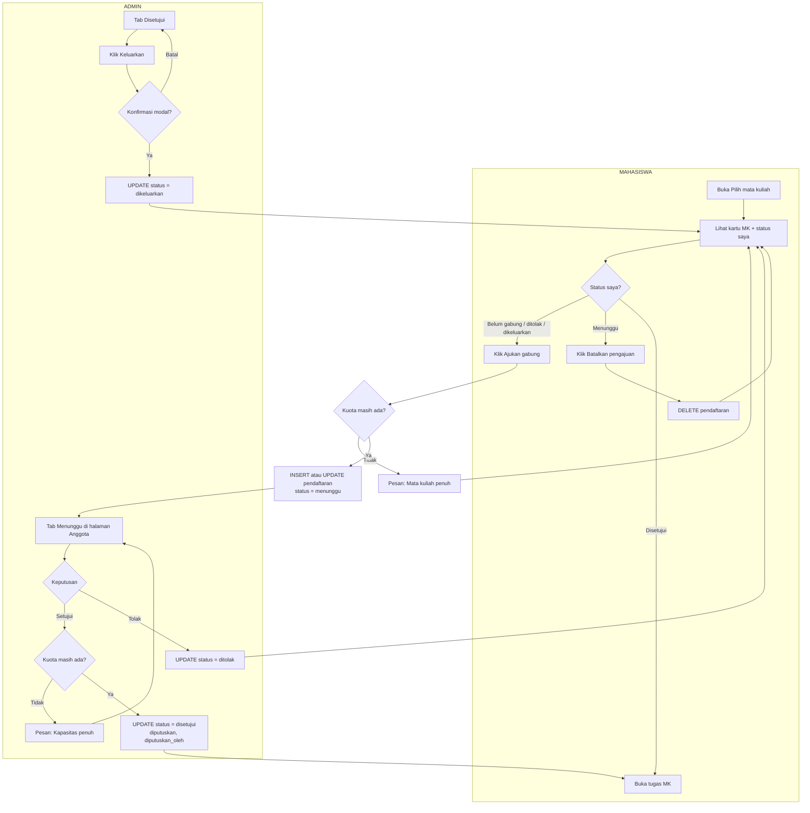

## 5. Admin mengelola mata kuliah (CRUD)

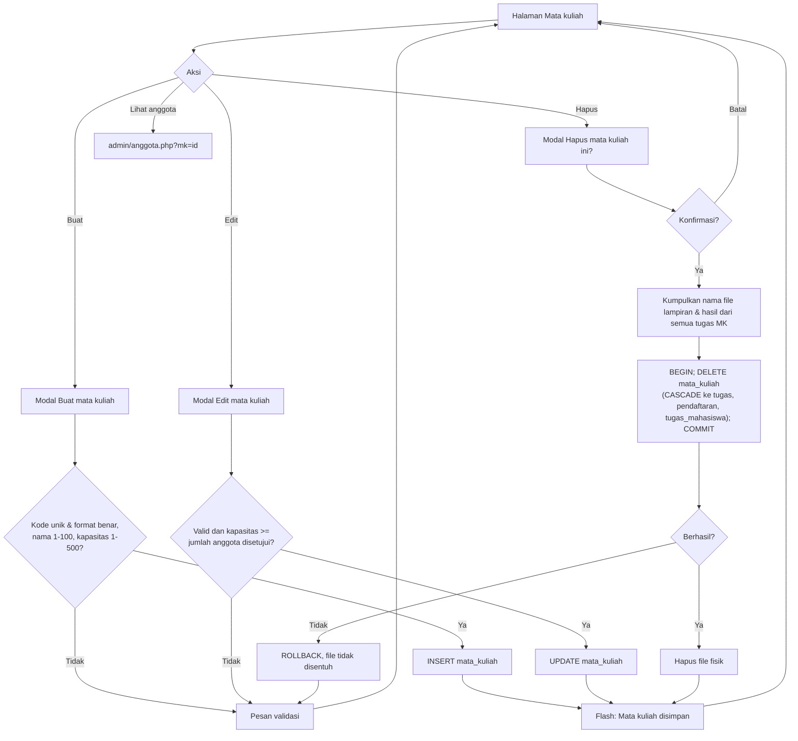

## 6. Admin mengelola tugas (CRUD + lampiran)

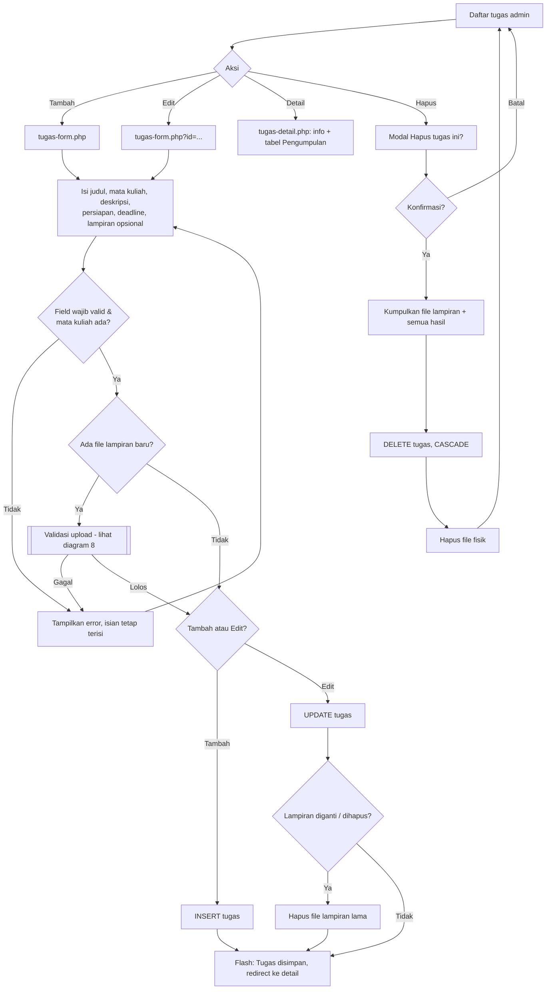

## 7. Mahasiswa mengerjakan tugas (ceklis + upload)

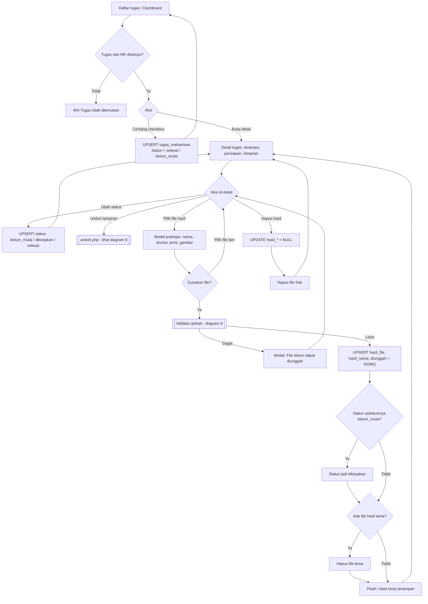

## 8. Validasi upload di server (`app/upload.php`)

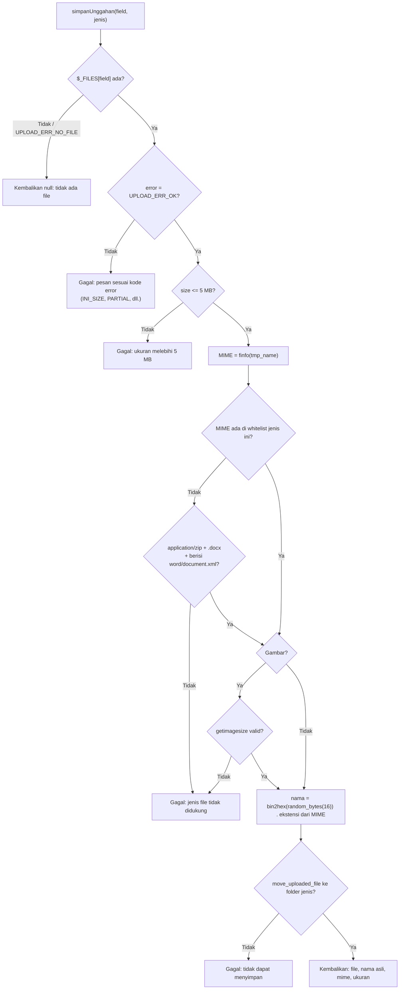

## 9. Otorisasi unduh file (`public/unduh.php`)

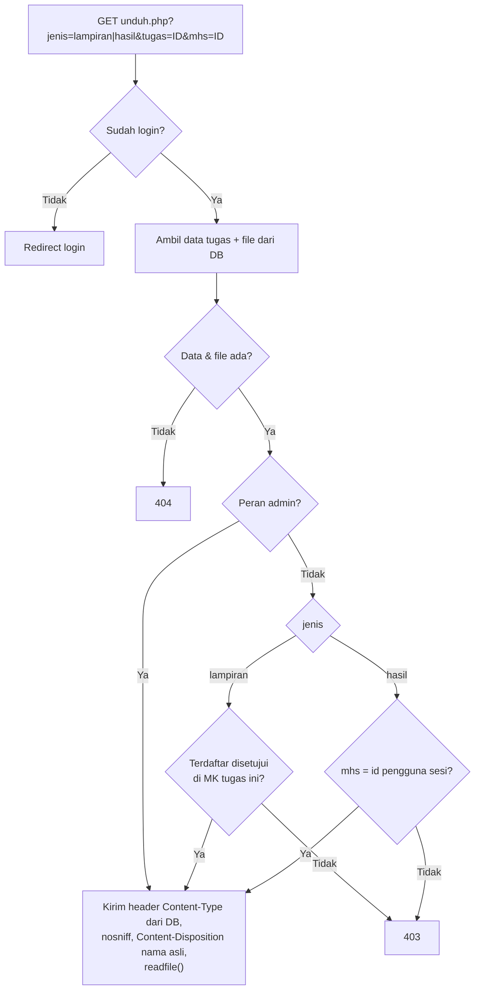

## 10. State diagram

Status pendaftaran mata kuliah:

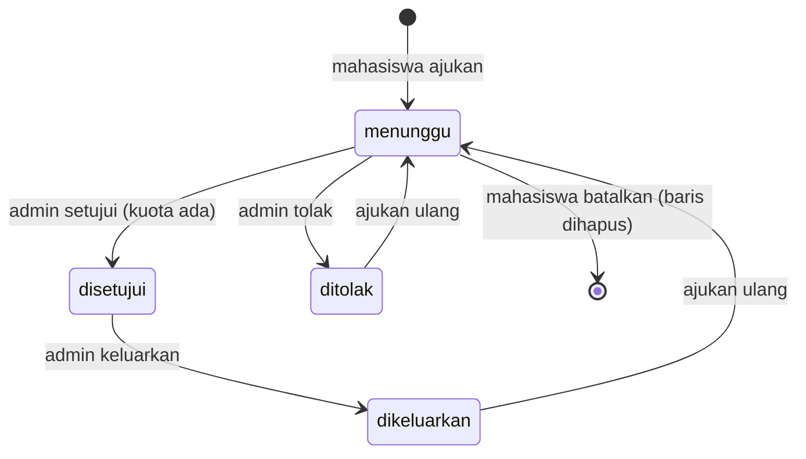

Status progres tugas (per mahasiswa):

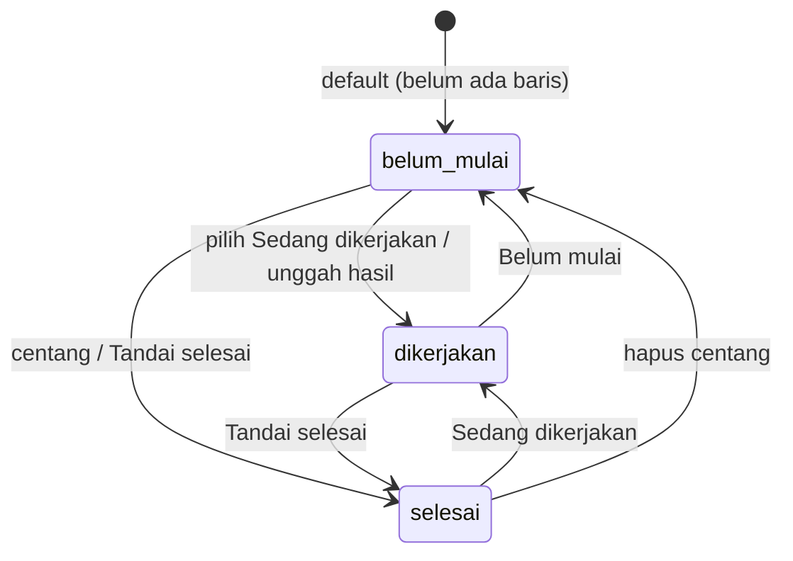

## 11. ERD

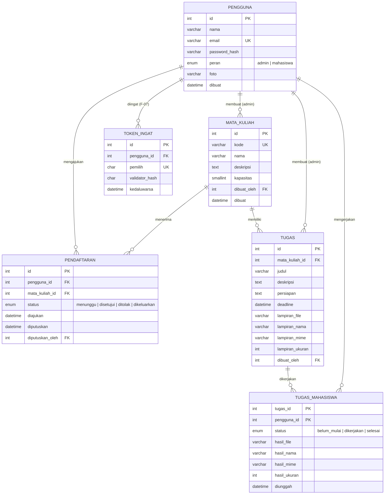

Catatan implementasi (sesuai `database/schema.sql`):
- `TOKEN_INGAT` menyimpan token "Ingat saya selama 30 hari" (F-07). Cookie berisi `pemilih:validator`;
  database hanya menyimpan hash SHA-256 validator, dan token dirotasi setiap kali dipakai.
- `MATA_KULIAH.dibuat_oleh` boleh `NULL` karena 4 mata kuliah contoh di `seed.sql` dibuat tanpa akun.
- Gambar `docs/flowchart-png/11-erd.png` dibuat sebelum tabel `TOKEN_INGAT` ditambahkan; diagram Mermaid di atas adalah versi terbaru.
